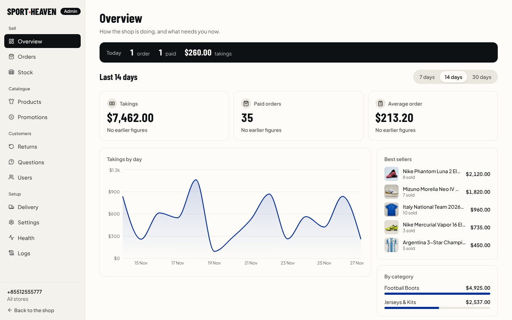
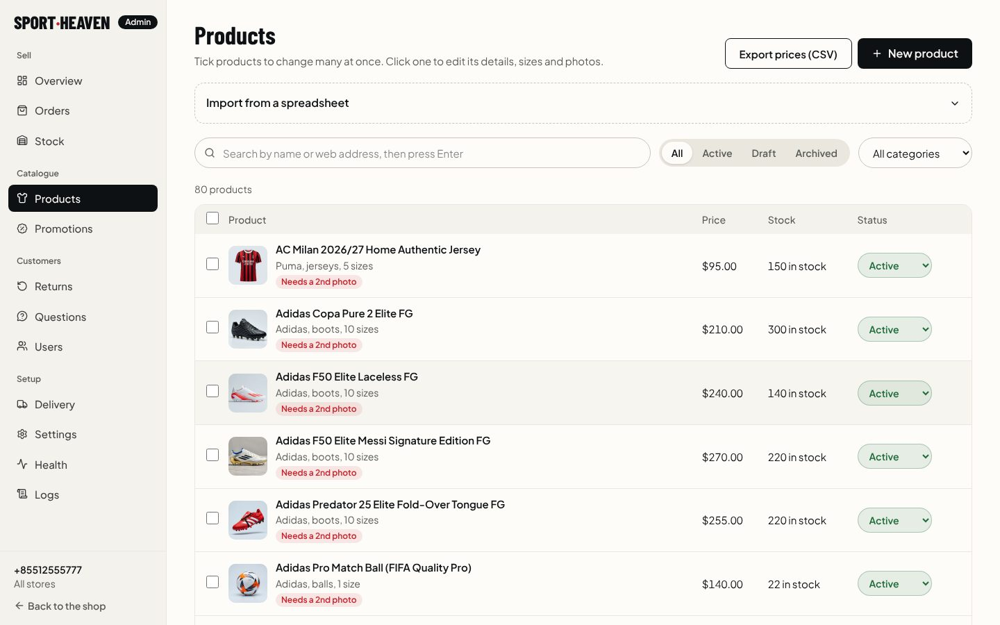
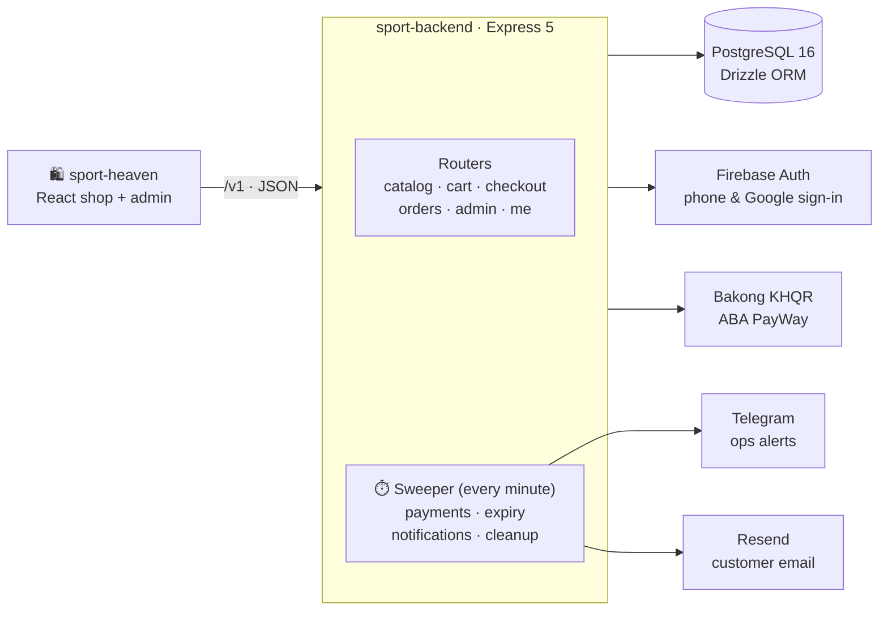
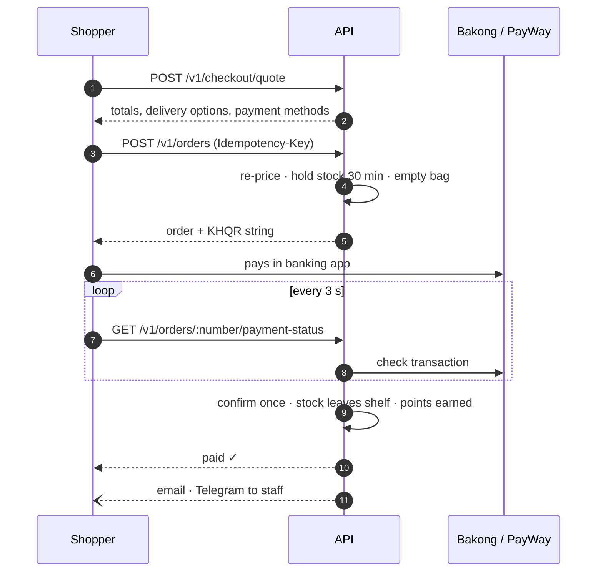

<div align="center">

# SPORT·HEAVEN API

**The commerce engine behind [Sport Heaven](https://github.com/danishsary8/sport-heaven) — a football, futsal and F1 store in Phnom Penh.**

Catalog · per-store stock · server-priced carts · KHQR & card payments · orders · returns · loyalty · admin

[](https://github.com/danishsary8/sport-backend/actions/workflows/ci.yml)


<br/>


<sub>The shop above runs entirely on this API.</sub>

</div>

---

## What it powers

<table>
  <tr>
    <td width="50%"></td>
    <td width="50%"></td>
  </tr>
  <tr>
    <td align="center"><code>GET /v1/admin/overview/sales</code><br/>Takings by Phnom Penh day, best sellers, by category — scoped to a staff member's store</td>
    <td align="center"><code>GET /v1/admin/products</code><br/>Live stock across three stores, bulk status, CSV import, photo uploads</td>
  </tr>
</table>

## Highlights

| | |
|---|---|
| 💰 **The server prices everything** | Clients send variant ids and quantities; any price they send is ignored. Team discounts, member perks, promo codes, delivery and the riel total are all worked out here. |
| 📦 **Stock that can't oversell** | Three stores, a safety buffer for walk-in sales, stock held while paying. Two shoppers racing for the last pair: exactly one wins. Load-tested at 50 concurrent checkouts. |
| 🇰🇭 **Cambodian payments** | Bakong KHQR (any banking app) or ABA PayWay (KHQR and card), with cash on pickup. Every payment is re-verified with the provider before it counts. |
| 🔁 **Never loses a payment** | Webhook, client polling and a per-minute sweeper all confirm payments; late payments re-hold stock or flag a refund with an urgent Telegram alert. |
| 🧾 **After the sale** | Order tracking, a staff order desk with pick lists, size exchanges and refunds, loyalty tiers and points, product Q&A. |
| 🛡️ **Hardened** | Per-route rate limits, validated config that refuses to boot when wrong, idempotent order placement, phone-number redaction in logs, an OpenAPI contract checked in CI. |

## How it fits together



### From bag to paid order



## Quick start

You need **Node 22** and **PostgreSQL 16**. To start Postgres in Docker:

```bash
docker run -d -e POSTGRES_PASSWORD=postgres -p 5432:5432 postgres:16
```

```bash
npm ci
```

```bash
cp .env.example .env
```

```bash
createdb -h localhost -U postgres sport_dev
```

```bash
npm run build && npm run db:migrate && npm run db:seed && npm run catalog:import
```

```bash
npm run dev
```

The API is now on **http://localhost:3000** — try `curl localhost:3000/v1/catalog/products?pageSize=1`. Without payment keys it uses a fake provider, so you can place and approve orders locally.

```jsonc
// GET /v1/catalog/products?pageSize=1
{
  "products": [{
    "slug": "adidas-f50-elite-messi-signature-edition-fg",
    "name": "Adidas F50 Elite Messi Signature Edition FG",
    "brand": { "slug": "adidas", "name": "Adidas" },
    "category": "boots",
    "priceCents": 27000,
    "compareAtCents": null,
    "sizes": ["EU 39", "EU 40", "EU 40.5", "…"],
    "availability": "ok",
    "lowStockCount": null
    // … images, colours, badges
  }],
  "total": 80, "page": 1, "pageSize": 1
}
```

## Tests

```bash
createdb -h localhost -U postgres sport_test
```

```bash
npm test
```

**98 test files, 760+ tests** — pure unit tests plus integration tests against a real Postgres, including concurrent-checkout races and payment-provider outages. CI also typechecks, lints, checks the OpenAPI contract is current, applies migrations and builds the Docker image.

## Scripts

| Command | Does |
|---|---|
| `npm run dev` | Run from source with reload |
| `npm run build` · `npm start` | Compile to `dist/` · run it |
| `npm test` · `test:unit` · `test:int` | All tests · unit only · against Postgres |
| `npm run typecheck` · `npm run lint` | Type and lint checks |
| `npm run db:generate` · `db:migrate` · `db:seed` | New migration from schema · apply · reference data |
| `npm run catalog:import` | Add the 80 storefront products (never overwrites admin edits) |
| `npm run contracts:openapi` | Regenerate `docs/api/openapi.json` |
| `npm run loadtest` | 50 concurrent checkouts for 10 units → exactly 10 orders |

## Project layout

```
src/
├─ server.ts · app.ts     boot, graceful shutdown, app factory
├─ config/env.ts          every setting validated at boot
├─ modules/               auth · account · catalog · stock · cart · pricing · checkout
│                         payments · orders · rma · loyalty · questions · admin · …
├─ jobs/sweeper.ts        the per-minute background work
├─ contracts/             Zod schemas → docs/api/openapi.json
└─ db/                    schema, migrations runner, seed data
drizzle/                  committed SQL migrations
test/                     unit + integration
```

## Documentation

| | |
|---|---|
| 📖 [**Full reference**](docs/REFERENCE.md) | Every endpoint, pricing rules, checkout and payment flow, HTTP conventions |
| 🚀 [Deployment](docs/DEPLOYMENT.md) | Production runbook, Docker, scaling |
| 💳 [Bakong setup](docs/BAKONG-SETUP.md) · [PayWay checklist](docs/PAYWAY-SANDBOX-CHECKLIST.md) | Before taking real payments |
| 📜 [OpenAPI contract](docs/api/openapi.json) | Machine-readable API description |
| 🔒 [Security pass](docs/superpowers/SECURITY-PASS.md) | What was reviewed and how |

<div align="center">
<br/>
<sub>Made in Phnom Penh 🇰🇭 · frontend: <a href="https://github.com/danishsary8/sport-heaven">sport-heaven</a></sub>
</div>
